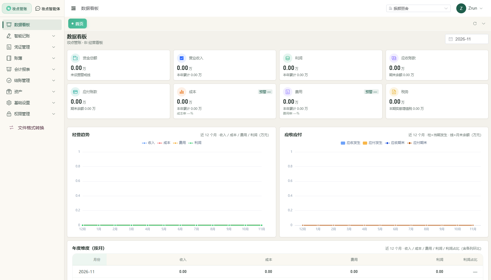
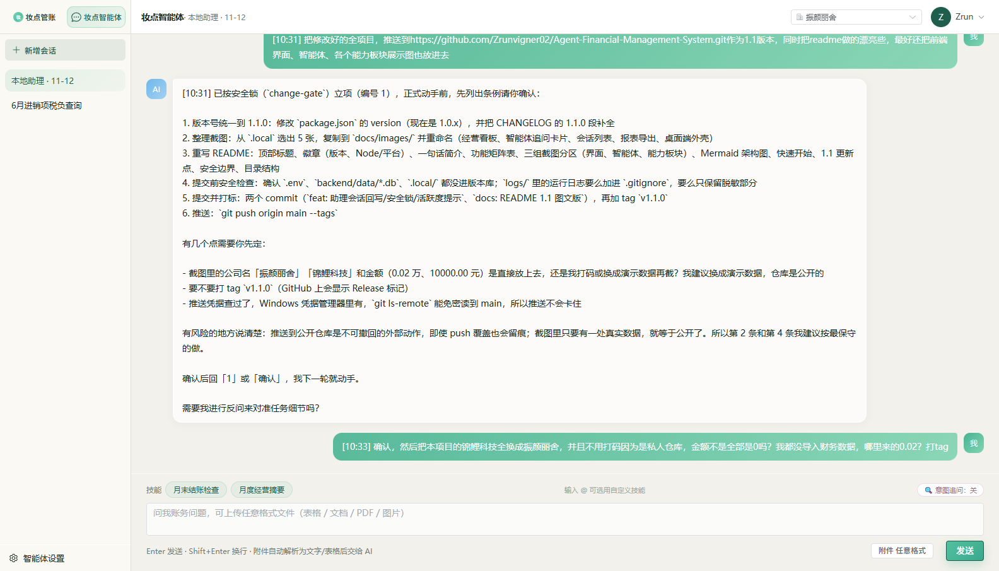
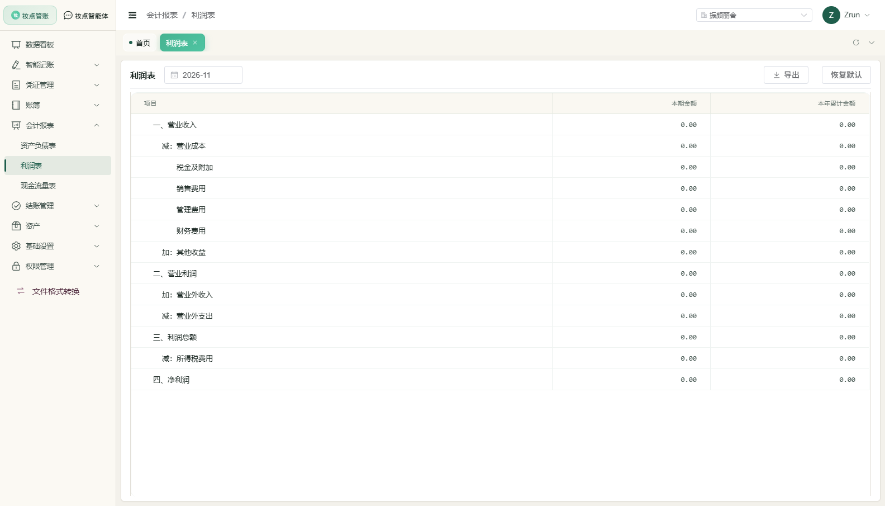
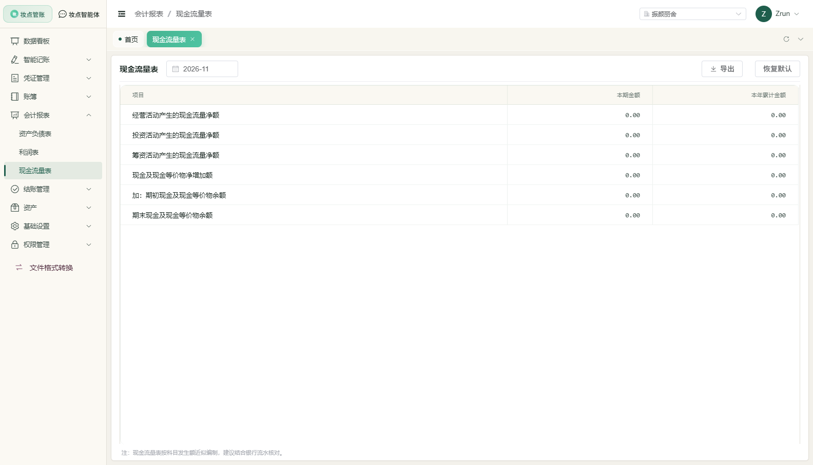
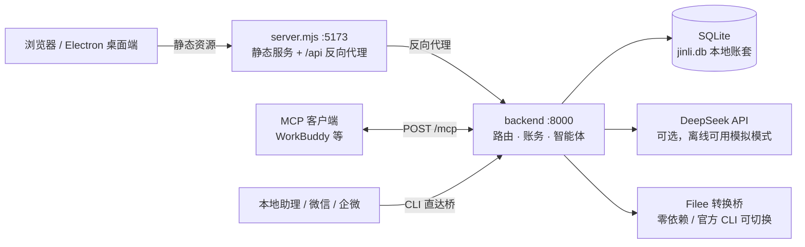

<div align="center">

# 妆点管账 · 本地智能财务系统

**Agent Financial Management System**

一套完全离线运行的本地财务账套 + AI 智能体 + 格式转换 + MCP 对接方案

[](CHANGELOG.md)
[](https://nodejs.org)
[](#)
[](#)
[](#)
[](https://github.com/Zrunvigner02/Agent-Financial-Management-System)

后端零外部 npm 依赖，基于 Node.js 内置模块与 `node:sqlite`；前端为已构建静态资源；桌面端为 Electron 外壳。
**所有业务数据留在本地 SQLite，不上云、不需要联网记账。**



</div>

---

## ✨ 它能做什么

| 板块 | 能力 |
| --- | --- |
| 📊 **账务核心** | 多账套隔离、科目表、凭证录入与校验、期初期末、余额与明细账、经营看板 |
| 🤖 **AI 智能体** | DeepSeek 接入、账套上下文注入、工具调用、逐步反问对准需求 |
| 📄 **三大报表** | 资产负债表 / 利润表 / 现金流量表，模板与公式可编辑、支持往来重分类 |
| 📤 **导出中心** | 凭证 / 余额 / 明细 / 三大报表，CSV / XLSX / JSON / MD / HTML 五种格式互转下载 |
| 🔁 **格式转换** | 兼容 Filee CLI 协议的本地零依赖实现，产出 PDF / DOCX / ODS / RTF / 图片等 |
| 🔌 **MCP 对接** | `POST /mcp`（streamableHttp）+ stdio 兜底桥，可被 WorkBuddy 等客户端直接调用 |
| 👤 **账号与权限** | 本机注册、管理员 / 普通用户自选、只读与记账分权、两阶段删除确认 |
| 🛡 **数据严谨** | 17 项独立审计、多轮核验、稳定快照哈希、隔离测试与可回滚清理 |
| 🖥 **桌面端** | Electron 外壳，托盘常驻，静默拉起本地服务，无黑框无公网依赖 |

---

## 🖼 界面一览

### 经营看板

<div align="center"></div>

资金总额、营业收入、成本、费用、利润、应收应付、税金一屏呈现，配 12 个月趋势与年度维度明细；金额单位统一为元，看板按万元展示。

### 智能体工作台

<div align="center"></div>

左侧会话列表按账套隔离，会话标题自动生成可人工改名；右侧对话支持附件、技能快捷入口与逐步反问。

### 会计报表

<table>
<tr>
<td width="50%"></td>
<td width="50%"></td>
</tr>
<tr>
<td align="center">资产负债表（期末 / 年初，支持往来重分类）</td>
<td align="center">利润表（本期 / 本年累计）</td>
</tr>
</table>

<div align="center"></div>

三张表的行项目、公式、层级全部落库：默认按小企业会计准则预置，可在线调整公式、增删行、恢复默认；公式是自研安全表达式（不使用 eval），只允许四则运算与 7 个取数函数，保存前即校验。

### 账簿与结账

<div align="center">


</div>

---

## 🧠 智能体：会先问清楚，再动手

这是本项目与「套壳聊天」最大的区别——**模糊需求不会被猜着做**。

```
用户：本月财务报表
     ↓  意图识别：报表类 · 规格不完整
智能体：你想要哪种结果形式？
  1. 只在消息里看摘要
  2. 生成详细报表文件
  3. 消息摘要 + 报表文件
  4. ✎ 其他补充…
```

- **grill-me 式逐步反问**：输出形式 → 报表类型 → 文件格式 → 期间 → 详略 → 确认，一次只问一题
- **可停可开**：「不用反问了」立即停用并记住；「开启追问」恢复
- **双通道一致**：网页端点击选项卡片，微信 / 企微本地助理侧用编号文本，同一套状态机
- **全格式附件**：51 种扩展名解析为文本与 `columns/rows`，原件留档
- **会话历史可追溯**：手机端每轮对话按天回写为一条会话，逐条带时间戳

---

## 🏗 架构



后端进程对外只监听 `127.0.0.1`，不做公网映射；桌面端与网页端共用同一份账套。

---

## 🚀 快速开始

环境：Node.js 22+（需支持 `node --env-file` 与 `node:sqlite`）；Python 3.8+ 可选（装 Pillow 后可渲染 PDF / 图片类格式）。

```bash
# 1) 配置模板（所有密钥留空，不会泄露任何凭据）
cp .env.example .env          # Windows: copy .env.example .env

# 2) 至少填写
#    DEEPSEEK_API_KEY=<你的 DeepSeek Key>
#    WB_MCP_TOKEN=<软件「设置 → 开放接口」生成的令牌>
#    FILEE_CLI=tools/filee-bridge.mjs

# 3) 一键启动（后端 :8000 + 前端 :5173）
npm run dev
# 浏览器打开 http://127.0.0.1:5173
```

桌面端（可选）：`desktop/` 下 `npm install` 装 Electron，然后 `pythonw desktop/launcher.pyw`（等价 `npm run desktop`）。

<details>
<summary><b>常用命令（点开）</b></summary>

| 命令 | 作用 |
| --- | --- |
| `npm run dev` | 后端 :8000 + 前端 :5173 一起起 |
| `npm start` | 只起前端静态服务与反向代理 |
| `npm run backend` | 只起本地后端（含 `/mcp`） |
| `npm run check` | 20+ 脚本语法检查 |
| `npm run regression` | 独立临时目录 + 独立库的全量回归（117 项） |
| `npm run smoke` | 隔离冒烟 + 看板核验 |
| `npm run test:title` | 会话自动命名单测（24 项） |
| `npm run audit:clean` | 数据审计三轮（17 项）+ 快照哈希 |
| `npm run cleanup:dry` | 预览待清理的测试数据 |
| `npm run desktop:check` | Electron 主进程语法检查 |

所有测试都在临时副本中运行，不会写入 `backend/data/jinli.db`。
</details>

---

## 📁 目录结构

| 路径 | 内容 |
| --- | --- |
| `backend/` | 本地后端：路由、账务、LLM、智能体、追问、附件、报表导出、Filee 集成、数据审计、会话命名、种子数据 |
| `upstream/` | 前端静态站：入口页、格式转换页、导出页、已构建资源、注入层 `clarify.js` |
| `desktop/` | Electron 桌面端源码与图标（不含 `node_modules/` 与 `runtime/node.exe`） |
| `tools/` | 测试与运维：回归、审计、清理、CDP 验证、MCP stdio 桥、Filee 转换桥、**修改安全锁**、界面截图 |
| `server.mjs` | 静态服务 + `/api` 反向代理（支持 `.env` 热读取） |
| `docs/` | Filee 集成说明、验证报告、`images/` 界面截图 |
| `logs/` | 本地运行日志（已忽略，不入库） |
| `analysis/` | 接口探测与回归快照（43 MB 逆向 gzip 产物不入库） |
| `release/` | 源码打包归档 |

---

## 👤 账号与权限

**注册**：只允许在安装本系统的机器上注册（`127.0.0.1`），局域网与远程一律拒绝。注册时可自选角色：

- **管理员**：全部权限，含账号、角色、账套、模型配置
- **普通用户**：只读。可看账簿与三大报表、可用智能体问答，但不能记账、不能改系统设置

密码要求 8-32 位且同时包含字母和数字；同一账号连续输错 5 次锁定 15 分钟（重启后仍有效）。会话有效期 7 天，过期自动失效。

**账号管理**（`/auth/accounts` 页面，或命令行）：

```bash
npm run account -- list                       # 列出账号
npm run account -- register 财务01 --password Fin2026abc --role user
npm run account -- passwd 财务01 --password New2026abc   # 重置密码并强制下线
npm run account -- role 财务01 admin          # 升/降级
npm run account -- status 财务01 off          # 停用（立即踢下线）
npm run account -- sets 财务01 85,86          # 限定可访问账套
npm run account -- unlock 财务01              # 清除登录失败锁定
npm run account -- delete 财务01              # 三次人工确认后软删除
```

**删除保护**：网页端删除要两次提交（第一次拿 60 秒有效令牌，第二次才执行）；命令行要连续两次输入完整用户名、再输入 `DELETE`。系统始终保留至少一个管理员，且不能删除当前登录账号。删除采用软删除：凭证创建人仍可追溯，用户名释放可复用。

**迁移到新设备**：账号存在 `backend/data/jinli.db`，连同账套、凭证、会话一起搬即可：

1. 新机装 Node.js 22+，拷项目（不带 `node_modules/`、`.local/`、`logs/`）
2. 拷 `backend/data/jinli.db` 与 `.env`
3. `npm run dev`，用原账号登录；若是全新库，初始管理员密码在 `.local/local-admin.txt`
4. 桌面端自动登录需要 `.local/desktop-credentials.json`（`{"username":"…","password":"…"}`），换机后重新生成

## 🆕 1.2.0 更新

- **本机注册**：`/register` 页面可用，仅限本机来源；注册可自选管理员 / 普通用户，密码强度校验、频率限制
- **权限分层**：管理类接口仅管理员；普通用户只读（账套数据 + 报表 + 智能体），记账需管理员或会计/出纳角色
- **账号管理补全**：改资料/角色、启停、账套分配、重置密码，全部真实落库并即时踢线
- **删除两阶段确认**：60 秒一次性令牌 + 至少保留一个管理员 + 禁止删自己，删除改软删除可追溯
- **登录安全**：失败 5 次锁 15 分钟（落库）、会话 7 天过期并定时清理、`/api/auth/logout` 可注销
- **命令行工具**：`npm run account -- …`，运维视角的账号操作
- **测试**：`tools/test-accounts.mjs` 10 项；全量回归 117 项保持全绿

## 🆕 1.1.1 更新

- **补齐三大报表**：资产负债表 / 利润表 / 现金流量表接入本地后端，`GET /api/reports/{balance|income|cash}?period=` 返回与前端一致的行结构，页面不再空白
- **模板与公式可编辑**：`PUT /api/reports/{type}/items`、`POST .../reset`、`GET /api/reports/balance/default-formulas`，行项目、公式、层级、排序全部落库（`report_templates`）
- **安全公式引擎**：自研递归下降解析，只允许 `+ - * / ()` 与 `QC/QM/QY/JE/DE/JEL/DEL` 七个取数函数，**不使用 eval**；非法公式保存即拒、计算时降级为 0 并给出告警
- **往来重分类**：应收贷方余额转预收、应付借方余额转预付，开关持久化（`report_settings`）
- **导出**：三大报表接入导出中心，`get_report` 新增 `balance/income/cash` 三种 kind，支持 xlsx/csv/json/md/html
- **单元测试**：`tools/test-reports.mjs` 11 项（取数口径、行间引用、借贷方向、公式安全、重分类、模板读写、非法输入）

## 🆕 1.1.0 更新

- **助理会话回写**：WorkBuddy 本地助理（网页 / 微信 / 企微）的每轮对话自动写入智能体历史，一天一条会话，逐条带 `[HH:MM]` 时间戳与本地时间，幂等去重
- **删除不复活**：`claw_deleted` 墓碑表 + 库级触发器，界面上删掉的会话不会再被同步拉回来；`--restore` 可按天恢复
- **会话活跃度提示**：`GET /api/agent/activity` + 桌面端 7 秒轮询，有新对话时右下角浮出提示条，不打断正在进行的对话
- **跨端补看**：`tools/desktop-pull.mjs` 按游标把桌面端新增对话带给手机助理
- **修改安全锁**：`tools/change-gate.mjs`，AI 改动项目必须「先列条例 → 用户确认 → 下一轮再改」

> 完整变更见 [CHANGELOG.md](CHANGELOG.md)。

---

## 🛡 安全边界

以下内容**刻意不进入版本库**：

- `.env`（含 `DEEPSEEK_API_KEY`、`WB_MCP_TOKEN`）、`.local/`（登录态、开放令牌、测试 profile）
- `backend/data/*.db*`（真实账套与令牌哈希，含所有 `.bak` 备份）
- `node_modules/`、`desktop/runtime/node.exe`、`*.exe/dll/pak/dat`、`__pycache__/`
- `analysis/*.gz`（逆向产物）

仓库内保留 `.env.example`、`backend/seed/`（演示种子数据，仅含令牌前缀）与脱敏日志。**提交前请确认 `git status` 无 `.env` 或 `.db` 文件。**

### 修改安全锁（change-gate）

AI 助理改动本项目必须走三拍：**先列条例 → 用户确认 → 下一轮再改**，禁止边说边改。

```bash
node tools/change-gate.mjs propose --title "标题" --steps "步骤1|步骤2" --files "a.mjs,b.mjs"
node tools/change-gate.mjs list          # 看全部提案与待批准项
node tools/change-gate.mjs approve 3     # 用户确认后执行，方可动手
node tools/change-gate.mjs reject 3 理由
node tools/change-gate.mjs check         # 有未批准提案时退出码 1
```

提案记录存 `.local/change-gate.json`（不入库、不碰账套）。只读排查不受限制。

---

## ✅ 验证结果

| 项目 | 结果 |
| --- | --- |
| 语法检查 | 20+ 文件全通过 |
| 全量回归 | 117 / 117 |
| 隔离冒烟 + 看板 | 17 / 17 + 11 / 11 |
| 会话命名单测 | 24 / 24 |
| 数据完整性专项 | 19 / 19 |
| 数据审计（三轮） | 17 / 17，快照哈希一致 |
| 真实 Chrome UI 验证 | 38 / 38，零 JS 异常、零 4xx/5xx |
| 三大报表单测 | 11 / 11（取数、引用、重分类、公式安全） |
| 账号体系单测 | 10 / 10（注册、锁定、踢线、过期、删除确认、越权） |

详见 [docs/VERIFICATION.md](docs/VERIFICATION.md)。

### 已知限制

- 图片附件仅解析元信息与文字片段，未内置 OCR
- 老式二进制 `.xls` 只能提取文字片段；CID 字体 PDF 可能乱码
- 图片 / PDF 渲染依赖 Python Pillow（未装时该格式明确报错，不影响其余功能）
- 桌面端 CDP 调试端口默认关闭

---

<div align="center">

**版本 1.2.0** · 变更记录见 [CHANGELOG.md](CHANGELOG.md) · 数据留在自己机器上

</div>
