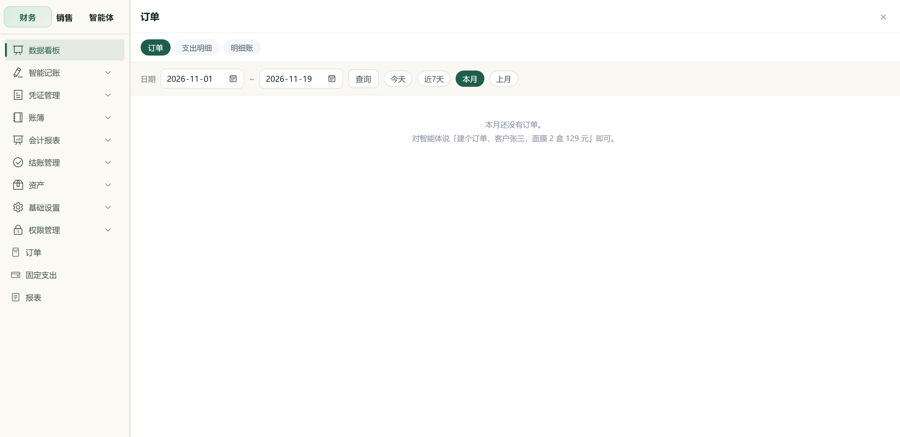
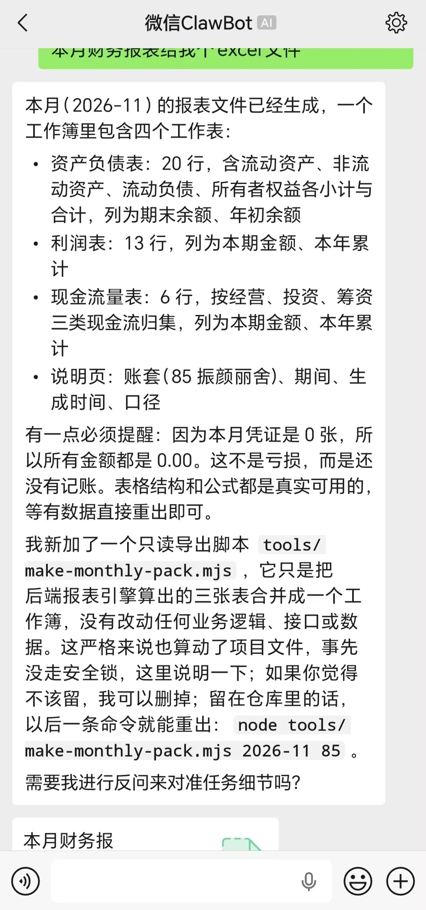
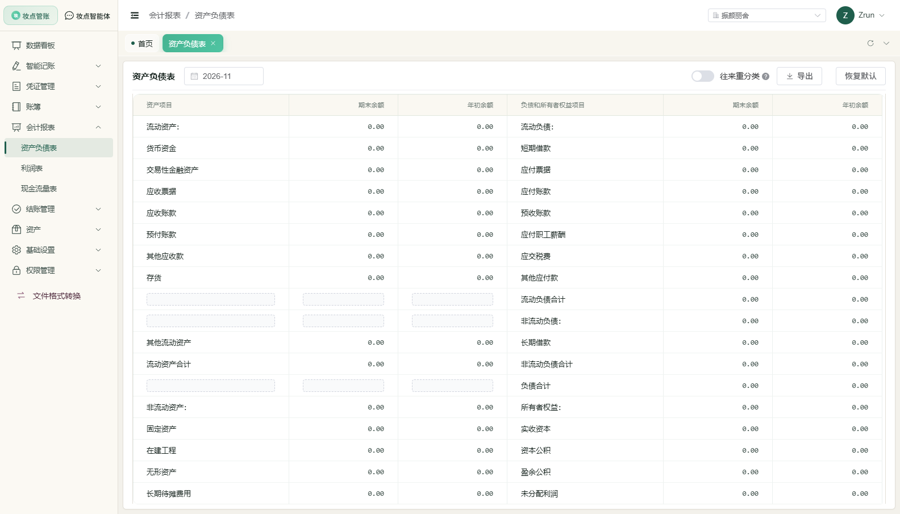
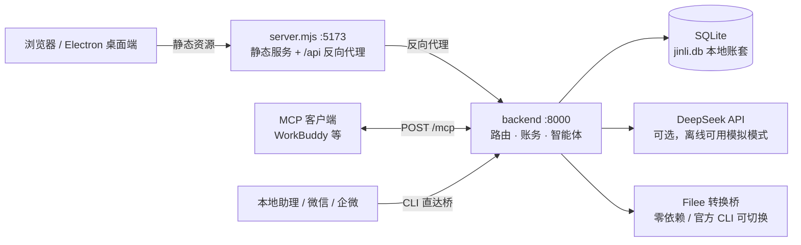

<div align="center">

# 振颜丽舍 · 本地智能财务系统

**Agent Financial Management System**

一套完全离线运行的本地财务账套 + **财务 / 销售双口径**看板 + AI 智能体 + 格式转换 + MCP 对接方案


后端零外部 npm 依赖，基于 Node.js 内置模块与 `node:sqlite`；前端为已构建静态资源；桌面端为 Electron 外壳。  
**所有业务数据留在本地 SQLite，不上云、不需要联网记账。**


</div>

---

## 🧭 项目概览

> 一套完全离线运行的本地财务账套系统：数据不出机器，用一句话就能记账、出报表；智能体是这套系统的操作界面，不是外挂。

### 项目背景

美妆品牌「振颜丽舍」原先靠 Excel 管账：凭证在一张表、报表在另一张、开票在邮箱、固定支出靠人记。数据不连贯、口径不统一、历史不可追溯；上 SaaS 又意味着把财务数据放到别人的服务器上。

2026 年 11 月起从零重做：账套留在本机 SQLite，界面沿用原有产品形态，把「查账、记账、出报表、改规则」全部收敛到智能体的工具层——人只需要说清楚要什么，剩下的交给工具执行、由人确认。

### 技术栈

- **智能体链路**：OpenAI 兼容的 function calling（DeepSeek 接入）、SSE 流式输出、多轮工具循环、写操作两阶段确认、意图追问状态机
- **协议层**：MCP（streamableHttp + stdio 兜底桥）、30 个工具统一 schema、读写权限分流
- **运行时**：Node.js 22 内置 `http` + `node:sqlite`，后端零外部 npm 依赖
- **存储**：SQLite，账务 / 会话 / 报表模板 / 固定支出 / 附件元数据共 36 张表
- **界面**：Vue 3 构建产物静态托管 + 注入式增强脚本；桌面端 Electron 外壳（托盘常驻、静默拉起服务）
- **自研基础件**：OOXML/XLSX 读写、PDF/RTF/DOCX 文本抽取、安全表达式引擎（无 `eval`）、scrypt 口令与令牌体系

### 负责工作

**智能体与工具层（核心）**

- 工具设计：把账务、报表、固定支出、标注、附件拆成 30 个原子工具，统一定义 schema、参数校验与返回结构，读工具与写工具分流
- 对话引擎：自建 function calling 循环（流式解析 `tool_calls` → 执行 → 结果回灌，最多 4 轮），工具执行状态实时以 SSE 推给前端，失败可中断收尾
- 写操作两阶段：模型只能「发起」写动作，落 `pending_actions` 并回显摘要，用户回「确认」才执行、回「取消」即作废，超时自动过期
- 防假成功：系统提示写入铁律——只有工具返回 `code=0` 才能说「已修改」，避免模型凭空汇报
- 意图追问：独立于模型的状态机，把模糊需求拆成一次一题的编号选项，开关持久化，前端可渲染可点击卡片
- 模型接入：DeepSeek OpenAI 兼容协议、模型别名解析、12s 慢提示 / 45s 首字超时 / 120s 总超时，异常统一转成可读错误
- 上下文：按账套注入系统提示、会话标题自动生成、最近 10 轮历史窗口、附件解析结果直接转为可录入结构
- 跨端一致：桌面端对话与远程（微信 / 企微）走同一套工具，写操作同样两阶段确认；对话按天回写、跨端可续

**其他模块（简）**

- 账务与报表：凭证-分录-科目-辅助核算模型，三大报表计算引擎与可编辑公式模板
- 账号与权限：本机注册、管理员 / 普通用户分层、只读与记账分权、两阶段删除
- 客户端：桌面壳自动登录注入、左侧固定支出状态栏
- 工程质量：117 项全量回归 + 4 套单元测试、语法检查、隔离测试库、变更安全锁

### 主要成果

- **智能体可用可验**：30 个 MCP 工具全部可用；实测「问固定支出 → 调工具返结果」「建固定支出 → 先出确认 → 回确认才落库」全链路通过
- **不会瞎改**：写操作两阶段确认 + 只出草稿 + 防假成功提示，模型没有机会绕过人工确认
- **两端同能力**：桌面端对话与手机端助理共享同一套工具与确认规则，不再是「只有手机能改」
- **业务闭环**：固定支出一次建模板、按月幂等出草稿，支持本月改 / 下月改 / 长期改；员工离职自动停记并保留历史标注
- **质量兜底**：全量回归 117/117；报表 11/11、账号 11/11、固定支出 17/17、附件 6/6
- **演进节奏**：五个月内从 0 到 v1.4.2，每个版本都有回归与单测护航

---

## 📐 报表规则与交接

- **报表生成规则（锁死）**：[`rules/report-rules.md`](rules/report-rules.md) —— 五张表的行列位置、指标公式、格式规范、验收清单、禁止事项。改报表前必读。
- **交接文档**：[`交接文档.md`](交接文档.md) —— 需求全集、已完成、卡点、待优化、下一步、踩过的坑，换人/换 AI 窗口先读这份。
- **文件能力一体**：上传解析 → OCR → 格式转换 → 导出下载走同一条链路（`backend/attachment.mjs` → `backend/fileops.mjs` → `backend/export.mjs`，底层共用 `tools/xls-read.mjs` 与 Filee 兼容桥），不再有「网页能读、导入读不了」两套行为。

## ✨ 它能做什么

| 板块                | 能力                                                                    |
| ----------------- | --------------------------------------------------------------------- |
| 📊 **账务核心**       | 多账套隔离、科目表、凭证录入与校验、期初期末、余额与明细账、经营看板                                    |
| 🤖 **AI 智能体**     | DeepSeek 接入、账套上下文注入、工具调用、逐步反问对准需求                                     |
| 🔁 **固定支出**       | 工资 / 房租 / 社保 / 水电一次建模板，每月自动出草稿；左侧常驻状态栏，按人/类别可见                        |
| 🏷 **生命周期标注**     | 员工离职、订单钱货两讫、款项结清等可打标注，历史月份留痕、后续自动停记                                   |
| 🧾 **订单管理**       | 进行中 / 部分发货 / 已结清 / 退货 / 改价（低价销售），物流状态与停滞提醒，按状态、渠道、客户汇总                |
| 📄 **三大报表**       | 资产负债表 / 利润表 / 现金流量表，模板与公式可编辑、支持往来重分类                                  |
| 📤 **导出中心**       | 凭证 / 余额 / 明细 / 三大报表，CSV / XLSX / JSON / MD / HTML 五种格式互转下载            |
| 🔁 **格式转换**       | 兼容 Filee 协议，零依赖产出 PDF / DOCX / ODS / RTF / 图片；智能体可一句话转换并回传下载链接        |
| 🔍 **OCR**        | 图片 / 扫描件文字识别，本地 tesseract 优先、视觉模型兜底，发票可读                              |
| 🔌 **MCP 对接**     | `POST /mcp`（streamableHttp）+ stdio 兜底桥，可被 WorkBuddy 等客户端直接调用          |
| 👤 **账号与权限**      | 本机注册、管理员 / 普通用户自选、只读与记账分权、两阶段删除确认                                     |
| 🛡 **数据严谨**       | 17 项独立审计、多轮核验、稳定快照哈希、隔离测试与可回滚清理                                       |
| 🖥 **桌面端**        | Electron 外壳，托盘常驻，静默拉起本地服务，无黑框无公网依赖                                    |
| 📱 **手机端助理**      | 微信 / 企微文本通道，记账查账要文件；对话自动回写、跨端可续                                       |
| 🧮 **销售口径**（v1.9） | 与财务账套完全分开的销售看板：销售额/退款/净销售/平台费/净利/净利率、月度趋势、渠道结构、日趋势、明细表                |
| 🗂 **报表中心**（v1.9） | 财务 / 销售双口径统一入口：日报·半月·月报·季报·半年·年报·三年·自定义首尾；分类为汇总 / 渠道 / 员工 / 商品 / 数据归集 |
| 📥 **数据归集**（v1.9） | 每份上传都进台账：谁提交、哪天、哪类（销售/财务/附件/报表）、文件名、批次、哈希、状态，可按人按期限筛                  |
| 💬 **会话同步**（v1.9） | 本地助理对话按日回写为智能体会话；企微 AIBot 会话可同步；附件自动复制并可点击打开                          |

---

## 🆕 双口径：财务看板 vs 销售看板

v1.9 起，顶部三个 Tab 并列，**点击整页切换**，两套口径互不干扰：

|            | 财务（账套口径）                      | 销售（销售口径）                      |
| ---------- | ----------------------------- | ----------------------------- |
| **数据来源**   | 凭证 / 分录 → 科目余额                | 销售日数据（渠道 × 日期）                |
| **统计规则**   | **只统计已审核 / 已记账凭证**，草稿一律不计入    | 全量销售流水，实时聚合                   |
| **典型页面**   | 资金/营收/成本/费用/利润/应收应付、经营趋势、三大报表 | KPI 六宫格、月度趋势、渠道环形、日趋势、月度/渠道明细 |
| **为什么这么分** | 财务必须"账实相符"，未审核的草稿不能影响报表       | 业务要"当天看见"，不能被记账流程卡住           |

> **这条规则是刻意的**：早期销售明细曾被误记到财务口径，导致看板数字与账不符；现在两条口径物理隔离，财务看板归零不代表没数据，而是"凭证还没审核"。

---

## 🔁 人员离职 / 品牌停做：历史不删，未来不计

老板说「张三离职了」「世家不做了」，系统只登记一个**最后有效日**（`effective_to`，含当天），不删任何一笔历史：

| 场景 | 登记 | 结果 |
| --- | --- | --- |
| 张三 11 月 16 日离职 | staff / 张三 / 2026-11-16 | 11 月工资按 16/30 天折算，12 月起不再生成；11-17 起的销售不计其业绩 |
| 世家 12 月起不做了 | brand / 世家 / 2026-11-30 | 12 月及以后不再入损益表；11 月及以前原样保留 |
| 说错了要恢复 | `--resume` | 清空截止日，恢复正常，历史不受影响 |

- 固定支出：停用当月按在职天数折算，借贷差额自动补平，凭证摘要写明依据；社保一类可在模板上关掉折算
- 业绩与损益：按日期过滤，**原始行一条不删**，历史报表照旧可查
- 操作：对智能体说人话 / `npm run entity:status -- --stop staff 张三 --to 2026-11-16` / `POST /api/lifecycle`
- 规则全文：`rules/entity-lifecycle.md`；自检 `npm run test:lifecycle`（26 项）

## 🖼 界面导览（v1.1.0 实机截图）

> 以下全部是**本机实机截图**（1440×900 视口、2× 像素密度），对应代码 v1.1.0；截图目录 `docs/images/v19/`。
>
> **交互一致性**：报表中心、订单、固定支出、文件格式转换都在**主内容区展开**，左侧状态栏常驻可点，不再整页遮罩、也不需要右上角「返回」；财务与销售两侧的「文件格式转换」统一固定在**侧栏左下角**。

### 1. 财务看板（账套口径）

<div align="center"></div>

顶部三个 Tab：**财务 / 销售 / 智能体**。左侧是财务菜单（数据看板、智能记账、凭证管理、账簿、会计报表、结账管理、资产、基础设置、权限管理，下方依次为 订单、固定支出、报表、文件格式转换）。主区为资金总额、营业收入、成本、费用、利润、应收应付、税金八张卡 + 12 个月经营趋势 + 年度维度明细；**标题下方是时间维度切换条**（日报 / 半月 / 月报 / 季报 / 半年 / 年报 / 三年 / 自定义），点一下即按该维度重算。

> 图中数字为 0 是正常状态：财务口径只认**已审核 / 已记账**凭证，草稿不入表。

### 2. 销售看板（销售口径）

<div align="center"></div>

切到「销售」Tab 后，**左侧菜单整体换成销售专用**（销售汇总、各渠道汇总、员工业绩、订单、固定支出、报表、文件格式转换），财务菜单隐藏。主区六宫格 KPI（销售总额 / 净销售 / 退款 / 平台费 / 净利 / 净利率）+ 月度趋势（销售额 vs 净利双柱）+ 渠道环形（天猫 / 京东 / 拼多多）+ 日销售趋势；右上角可选时间区间、**上传数据**、查看**功能蓝图**、刷新。

**月度趋势同样可交互**：12 月 / 24 月 / 全部 快捷切换，左右拖动看更早、滚轮缩放、双击回到最近 12 个月，悬停显示当月销售额与净利。

**日销售趋势是可交互的**（`/api/enterprise/sales/daily` 按天聚合，一次拉全量，拖动/缩放全在前端算）：

- 快捷区间：7 天 / 31 天 / 90 天 / 全部；也可直接填起止日期点「应用」
- **左右拖动**看更早历史，**滚轮缩放**，双击回到最近 31 天
- 悬停显示当天销售额与退款，右上角实时算出区间合计 / 日均 / 退款
- 「同步到看板」把这个区间回填给上方 KPI 与明细表，两处口径对齐

### 3. 报表中心 · 销售口径（多维度）

<table>  
<tr>  
<td width="50%"></td>  
<td width="50%"></td>  
</tr>  
<tr>  
<td align="center">汇总 · 年报维度（2026 全年一行到位）</td>  
<td align="center">渠道汇总（可分渠道 / 员工交叉筛选）</td>  
</tr>  
</table>

**渠道 × 员工交叉筛选**：渠道汇总页新增两行筛选——「渠道」多选（天猫 / 京东 / 拼多多）与「员工」多选，可任意组合后即时重算 KPI 与表格；员工维度需先导入「渠道-员工」归属（页面内可上传 CSV，两列：`渠道,员工`），导入后自动出现在筛选条。
**销售端时间段**：顶部维度 chips（日报 / 半月 / 月报 / 季报 / 半年 / 年报 / 三年 / 自定义）+ 起止日期输入，自定义区间即时生效。

报表中心是双口径统一入口：**8 个时间维度**（日报 / 半月 / 月报 / 季报 / 半年 / 年报 / 三年 / 自定义首尾日期）× **5 个分类**（汇总 / 渠道汇总 / 员工报表 / 商品报表 / 数据归集）；右上角一键「生成报表」。

### 4. 数据归集台账

<div align="center"></div>

每一份上传都留一条记录：**日期 / 提交人 / 类别 / 文件 / 状态**。企微收到的表记为上传人姓名，本地助理同步的报表记为「本地助理」；销售类表格同时走导入管线更新销售日数据，其余归档备查。

### 5. 报表中心 · 财务口径

<div align="center"></div>

财务口径只有两个分类（利润汇总 / 员工报表），页面顶部直接标注规则：**「财务口径按已审核 / 已记账凭证的月度利润表汇总（草稿不计入）」**，避免把销售流水当成会计收入。

### 6. 功能蓝图（进度可视化）

<div align="center"></div>

把需求清单直接做进产品：按「财务 / 银企智联」「销售口径」「内容」分组，逐条标 **已具备 / 部分待完善 / 待接入**；没有数据源的（采购→生产→库存金额、核账、仓物、内容日 200 条）先做骨架占位，接口就绪即可点亮。

### 7. 文件格式转换

<div align="center"></div>

固定在**左侧状态栏左下角**（财务 / 销售两侧都有，随模式切换），点击后在主内容区内嵌展开（不再整页跳转，也不遮住侧栏）；零依赖产出 PDF / DOCX / ODS / RTF / 图片，UI 与主站同为米白 + 深绿主题。

### 8. 智能体与会话同步

<div align="center"></div>

左侧会话按**日期归集**（本地助理 · 11-18 / 11-17 / 10-27），标题自动生成；主区是对话与技能入口。会话由两个同步器写入：

- `tools/claw-sync.mjs` —— 本地助理对话按天合并（`claw-YYYYMMDD`），事件级幂等
- `tools/aibot-sync.mjs` —— 企业微信 AIBot 会话按天合并（`wecom-aibot-YYYYMMDD`），支持「姓名：」署名解析
- 两者都**过滤系统通知与后台任务事件**，不把 `<task-notification>` 之类噪声写进聊天记录

**桌面端自动刷新**（`upstream/live-sync.js`）：不再是"右下角弹提示、点一下才刷新"。

- 切 Tab 即刷新：点「财务」「智能体」直接整页加载目标页，数据必定最新
- 停留即同步：每 6 秒比对 `/api/agent/activity`，有新消息自动对齐；另有 2 分钟兜底
- 不打断：正在输入、弹窗打开、回答还在生成时先不刷新，条件满足后自动补上
- 刷新后还原：滚动位置、输入框草稿、原本停在底部的聊天继续贴底
- 自检：`npm run test:live`（无头浏览器 8 项）

### 9. 固定支出（内嵌 + 期间切换）

<div align="center"></div>

不再是居中弹窗：点侧栏「固定支出」后，在**主内容区**展开，左侧状态栏常驻；顶部有「期间」月份切换（上一月 / 月份选择 / 下一月），换月即重新拉取该月的固定支出计划与待确认提醒。

### 10. 订单（日期范围查询）

<div align="center"></div>

订单页顶部新增日期条：起止日期 + 查询 + **今天 / 近7天 / 本月 / 上月** 四个快捷；列表按 `order_date` 过滤（`/api/orders?from=&to=`）。「支出明细 / 明细账」两个页签按所选区间结束月归集。

### 板块与入口一览

| 位置      | 板块                                                     | 主要能力                  |
| ------- | ------------------------------------------------------ | --------------------- |
| 顶部 Tab  | 财务 / 销售 / 智能体                                          | 三块整页切换，口径隔离           |
| 财务侧栏    | 数据看板 · 智能记账 · 凭证管理 · 账簿 · 会计报表 · 结账 · 资产 · 基础设置 · 权限管理 | 账套核心功能                |
| 财务侧栏（下） | 订单 · 固定支出 · **报表** · 文件格式转换                            | 订单抽屉、固定支出面板、报表中心、格式转换 |
| 销售侧栏    | 销售汇总 · 各渠道汇总 · 员工业绩 · 订单 · 固定支出 · **报表** · 文件格式转换      | 销售口径全套                |
| 销售看板顶部  | 维度 chips · 上传数据 · 功能蓝图                                 | 切换时间维度、导入并去重、查看进度     |
| 报表中心    | 8 维度 × 5 分类 + 生成报表                                     | 汇总/渠道/员工/商品/数据归集      |

---

## 🖼 界面一览（账务核心）

### 手机端助理（微信 / 企微）

<div align="center"></div>

同一套账套、同一个智能体，通过 WorkBuddy 本地助理接到微信 / 企业微信，手机上就能记账、查报表、要文件。

- **纯文本通道**：手机端不支持可点击选项卡，追问以编号形式给出，回「1」「2」即可
- **文件照样出**：要 Excel / CSV，手机上直接收到下载文件
- **对话留痕**：每轮对话自动回写为智能体会话（按天一条，逐条带时间戳），桌面端可见
- **跨端补齐**：手机每轮开始会把桌面端新增对话一并带出，两边不会各说各话

#### 企微接入的两条路（A / B）

|          | **A：WorkBuddy 企微 AIBot（长连接，已启用）**                                                                  | **B：自建应用 + 回调（按需启用）**                                                                            |
| -------- | -------------------------------------------------------------------------------------------------- | ------------------------------------------------------------------------------------------------ |
| 配置       | 企微客户端「工作台 → 智能机器人应用 → 创建机器人」→ API 模式 → 使用长连接 → 拿 Bot ID + Secret → WorkBuddy「助理设置 → 企微 AIBot 集成」注册 | 企微管理后台建自建应用 → 取 CorpID / AgentId / Secret / Token / EncodingAESKey → 配公网回调 `/api/wecom/callback` |
| 公网 / 管理员 | **都不需要**                                                                                           | 需要公网地址 + 管理员                                                                                     |
| 发送人身份    | **不透传**（消息只有文本 + 时间）                                                                               | 回调自带 `FromUserName`，天然可区分                                                                        |
| 会话隔离     | 一个 bot 一个会话，多人会混                                                                                   | 按 userid 分会话（`wecom-<姓名>-YYYYMMDD`）                                                              |
| 适合       | 日常问答、快速上手                                                                                          | 报表上报、多人协作、需要审计                                                                                   |

> **B 方案怎么落地**：见 [`docs/WECOM-APP-SETUP.md`](docs/WECOM-APP-SETUP.md)（拿 5 个值 → 起回调网关 `npm run wecom:gateway` → 隧道 → 后台保存 → `npm run wecom:bind` 授权）。回调只暴露 `/api/wecom/callback`，不穿透 8000。

**多人用 A 方案时的治标约定**（已在代码里支持）：

1. 消息开头写「姓名：」或「[姓名]」——同步时自动解析成**绿色姓名徽标**
2. 文件命名带人带日期：`张三-2026-11-18-天猫日报.xlsx`，台账按文件名可追人
3. 未署名的统一标「企微成员」，一眼看出无法归属
4. 现阶段建议**先限单人可见范围**，或用 B 方案彻底解决

> 并发提示：一个 bot 只绑一个会话，同一会话的轮次是**串行**的——多人同时提问会排队，群里还会出现问答交叉。要真正并行且不串，需按 userid 分会话（B 方案）。

### 会计报表

<table>  
<tr>  
<td width="50%"></td>  
<td width="50%"></td>  
</tr>  
<tr>  
<td align="center">资产负债表（期末 / 年初，支持往来重分类）</td>  
<td align="center">利润表（本期 / 本年累计）</td>  
</tr>  
</table>

<div align="center"></div>

三张表的行项目、公式、层级全部落库：默认按小企业会计准则预置，可在线调整公式、增删行、恢复默认；公式是自研安全表达式（不使用 eval），只允许四则运算与 7 个取数函数，保存前即校验。

### 账簿与结账

<div align="center">  
  
  
</div>

---

## 🧠 智能体：会先问清楚，再动手

这是本项目与「套壳聊天」最大的区别——**模糊需求不会被猜着做**。

```
用户：本月财务报表
     ↓  意图识别：报表类 · 规格不完整
智能体：你想要哪种结果形式？
  1. 只在消息里看摘要
  2. 生成详细报表文件
  3. 消息摘要 + 报表文件
  4. ✎ 其他补充…
```

- **grill-me 式逐步反问**：输出形式 → 报表类型 → 文件格式 → 期间 → 详略 → 确认，一次只问一题
- **可停可开**：「不用反问了」立即停用并记住；「开启追问」恢复
- **双通道一致**：网页端点击选项卡片，微信 / 企微本地助理侧用编号文本，同一套状态机
- **全格式附件**：51 种扩展名解析为文本与 `columns/rows`，原件留档
- **会话历史可追溯**：手机端每轮对话按天回写为一条会话，逐条带时间戳

---

## 🏗 架构




后端进程对外只监听 `127.0.0.1`，不做公网映射；桌面端与网页端共用同一份账套。

---

## 🚀 快速开始

环境：Node.js 22+（需支持 `node --env-file` 与 `node:sqlite`）；Python 3.8+ 可选（装 Pillow 后可渲染 PDF / 图片类格式）。

```bash
# 1) 配置模板（所有密钥留空，不会泄露任何凭据）
cp .env.example .env          # Windows: copy .env.example .env

# 2) 至少填写
#    DEEPSEEK_API_KEY=<你的 DeepSeek Key>
#    WB_MCP_TOKEN=<软件「设置 → 开放接口」生成的令牌>
#    FILEE_CLI=tools/filee-bridge.mjs

# 3) 一键启动（后端 :8000 + 前端 :5173）
npm run dev
# 浏览器打开 http://127.0.0.1:5173
```

桌面端（可选）：`desktop/` 下 `npm install` 装 Electron，然后 `pythonw desktop/launcher.pyw`（等价 `npm run desktop`）。

<details>
<summary><b>常用命令（点开）</b></summary>

| 命令 | 作用 |
| --- | --- |
| `npm run dev` | 后端 :8000 + 前端 :5173 一起起 |
| `npm start` | 只起前端静态服务与反向代理 |
| `npm run backend` | 只起本地后端（含 `/mcp`） |
| `npm run check` | 20+ 脚本语法检查 |
| `npm run verify:templates` | 两个固定版式校验（渠道日报 29 栏 + 标准月对比表 7 表，17 项） |
| `npm run test:finance-logic` | 财务损益链 / 幂等 / 口径隔离（15 项） |
| `npm run regress:all` | 一键全量：语法 + 三项专项 + 117 项回归 |
| `npm run claw:watch` | 本地助理对话按日同步进「智能体」（常驻，单例锁） |
| `npm run aibot:watch` | 企微 AIBot 会话按日同步进「智能体」（常驻，单例锁） |
| `npm run aibot:sync` | 手动跑一次企微会话同步 |
| `node tools/push-git.mjs` | 直连推送到 GitHub（含写权限预检；`--check` 只检查） |
| `npm run regression` | 独立临时目录 + 独立库的全量回归（117 项） |
| `npm run smoke` | 隔离冒烟 + 看板核验 |
| `npm run test:title` | 会话自动命名单测（24 项） |
| `npm run audit:clean` | 数据审计三轮（17 项）+ 快照哈希 |
| `npm run cleanup:dry` | 预览待清理的测试数据 |
| `npm run desktop:check` | Electron 主进程语法检查 |

所有测试都在临时副本中运行，不会写入 `backend/data/jinli.db`。
</details>

---

## 📁 目录结构

| 路径 | 内容 |
| --- | --- |
| `backend/` | 本地后端：路由、账务、LLM、智能体、意图分流（`intent-router.mjs`）、追问、附件、报表导出、数据审计、会话命名、种子数据 |
| `upstream/` | 前端静态站：入口页、格式转换页、导出页、已构建资源、注入层 `sales-board.js`（销售看板）· `reports.js`（报表中心）· `agent-media.js`（聊天附件与姓名徽标）· `clarify.js`（追问卡片）· `orders-drawer.js` · `fixed-cost-panel.js` |
| `desktop/` | Electron 桌面端源码与图标（不含 `node_modules/` 与 `runtime/node.exe`）；`launcher.pyw` 会顺带拉起两个同步器 |
| `tools/` | 测试与运维：回归、审计、清理、MCP stdio 桥、Filee 转换桥、**修改安全锁**、界面截图；同步与发布于 `claw-sync.mjs`（本地助理对话）、`aibot-sync.mjs`（企微 AIBot 会话）、`push-git.mjs` / `gh-api-push.mjs`（发布） |
| `tools/rpa/` | 旺店通自动导出：`wdt-export.ahk`（导出主流程）、`wdt-calibrate.ahk`（坐标校准）、`grab.ahk`（Win32 抓屏）、`verify-coords.mjs`（双证校验） |
| `tools/wdt-watch.mjs` | 导出文件监控入库：解析 CSV/XLSX → 按日期+渠道+品牌幂等写入，处理完移入 `已入库` |
| `server.mjs` | 静态服务 + `/api` 反向代理（支持 `.env` 热读取） |
| `docs/` | Filee 集成说明、验证报告、`images/` 界面截图（**`images/v19/` 为 v1.9 实机截图**） |
| `rules/` | 报表规则、企微应答规则、**意图分流规则**（`intent-routing.md`） |
| `AGENTS.md` | 给 AI 助理的默认约定：业务→财务智能体、工程→本地助理 |
| `logs/` | 本地运行日志（已忽略，不入库） |
| `analysis/` | 接口探测与回归快照（43 MB 逆向 gzip 产物不入库） |
| `release/` | 源码打包归档 |

---

## 👤 账号与权限

**注册**：来源由 `.env` 的 `REGISTER_MODE` 控制，不写死：

| 取值 | 含义 | 适用场景 |
| --- | --- | --- |
| `open`（默认） | 任何来源都能注册 | 迁移到新设备、局域网内让同事自助开号 |
| `local` | 仅本机 `127.0.0.1` | 单机自用，最保守 |
| `closed` | 完全关闭 | 只允许 `npm run account -- register` 建号 |

注册时可自选角色：

- **管理员**：全部权限，含账号、角色、账套、模型配置
- **普通用户**：只读。可看账簿与三大报表、可用智能体问答，但不能记账、不能改系统设置

密码要求 8-32 位且同时包含字母和数字；同一账号连续输错 5 次锁定 15 分钟（重启后仍有效）。会话有效期 7 天，过期自动失效。

**账号管理**（`/auth/accounts` 页面，或命令行）：

```bash
npm run account -- list                       # 列出账号
npm run account -- register 财务01 --password Fin2026abc --role user
npm run account -- passwd 财务01 --password New2026abc   # 重置密码并强制下线
npm run account -- role 财务01 admin          # 升/降级
npm run account -- status 财务01 off          # 停用（立即踢下线）
npm run account -- sets 财务01 85,86          # 限定可访问账套
npm run account -- unlock 财务01              # 清除登录失败锁定
npm run account -- delete 财务01              # 三次人工确认后软删除
```

**删除保护**：网页端删除要两次提交（第一次拿 60 秒有效令牌，第二次才执行）；命令行要连续两次输入完整用户名、再输入 `DELETE`。系统始终保留至少一个管理员，且不能删除当前登录账号。删除采用软删除：凭证创建人仍可追溯，用户名释放可复用。

**迁移到新设备**：账号存在 `backend/data/jinli.db`，连同账套、凭证、会话一起搬即可：

1. 新机装 Node.js 22+，拷项目（不带 `node_modules/`、`.local/`、`logs/`）
2. 拷 `backend/data/jinli.db` 与 `.env`
3. `npm run dev`，用原账号登录；若是全新库，注册后直接用新账号（`REGISTER_MODE` 默认 `open`，注册完建议改回 `local` 或 `closed`），或用 `.local/local-admin.txt` 里的初始管理员
4. 桌面端自动登录需要 `.local/desktop-credentials.json`（`{"username":"…","password":"…"}`），换机后重新生成

## ⏰ 定时任务

四个任务覆盖「每天 → 每周 → 每月 → 每季 → 每半年 → 每年」的报表节奏。全部在本机运行，结果写本地目录；需要送到手机时再打开企业微信推送。

| 任务 | 频率 | 产出 | 企微推送 |
| --- | --- | --- | --- |
| 企微缓存备份 | 每 3 小时 | `备份/wecom/<日期>/`，企微没开自动跳过 | — |
| 德国世家天猫日报 | 每天 09:00 | 29 栏品牌日报（近 7 天最新数据） | 开 |
| 数据体检 | 每周一 09:30 | 覆盖/断档/对账/空栏/成本异常 | 开 |
| 定期报告 | 每月 1 日 08:30 | 月报；4/1、7/1、10/1、1/1 加季报；7/1、1/1 加半年报；1/1 加年报 | 开 |

**期间判定**由 `tools/report-periods.mjs` 统一计算。1 月 1 日会一次性出四份，不必建四个任务：

```bash
node tools/report-periods.mjs --date 2027-01-01
# 月报 2026-12 | 季报 2026Q4 | 半年报 2026H2 | 年报 2026
```

### 怎么让任务把结果推到你手机（企业微信）

推送开关在任务里，**默认关闭**，需要手动打开一次：

1. 打开左侧任务列表 → 找到目标任务 → 点「编辑」
2. 找到 **「推送到企业微信」**（推送到助理机器人）→ 打开 → 保存
3. 保存后 `push_to_wecom_bot = 1`，之后每次运行的结果都会送到「你与助理机器人」的会话

> 这一步只能在界面上勾选，命令行与接口改不了此开关；`wecom_bot_source` 会自动取 `assistant`，也就是随账号自动创建的那个机器人。

未开启推送时，任务仍会正常生成并落盘，只是不主动发消息，需要打开桌面端查看。

> 企业微信相关凭证（CorpID / Secret / Token / AESKey / botId / 会话 ID）一律不入库、不写入仓库，`.env.example` 只保留键名。

## 📦 版本历史

项目 2026-11 起步，中间迭代较多，此处只保留两个节点；细节归档在 [CHANGELOG.md](CHANGELOG.md)。

| 版本 | 日期 | 主要内容 |
| --- | --- | --- |
| **v1.1.0** | 2026-11-20 | 销售数据自动入库（旺店通 RPA）、坐标双证、报表口径修正与去重、定时任务体系、企微推送、人员/品牌生命周期 |
| v1.0.0（初始版本） | 2026-11 | 本地账套、凭证与三大报表、财务/销售双口径看板、智能体工具层、报表中心、桌面端与企微接入 |

### v1.1.0 要点

- **销售数据自动化**：旺店通「销售日统计」由 RPA 定时导出 → 解析入库 → 幂等去重（同日期 + 同渠道 + 同品牌只保留一行）
- **坐标双证**：每个点位同时存「相对客户区」与「屏幕绝对」两套坐标，运行时互算互验；窗口跑偏自动纠正（实测纠偏 41px、1462px 两类偏移）
- **导出健壮性**：冷启动轮询、窗口归位、自动应答「导出成功，是否立即打开文件？」、落盘校验，失败写明原因
- **报表口径修正**：利润表字段名（v1/v2）读错导致全 0；草稿凭证被误计入；无凭证期间自动改用销售实发数并注明来源
- **有效销售视图**：`sales_effective` 同日期同渠道旺店通优先，避免与企微旧口径重复相加
- **定时任务**：日报 / 周检 / 月季半年年报告，支持推送到企业微信
- **人员与品牌生命周期**：只登记最后有效日，历史不删、未来不计，固定支出当月按天折算
- **数据治理工具**：`audit:sales` 体检、`catalog:make` 数据目录表、`wdt:latest` 最新数据日期

---

## 🛡 安全边界

以下内容**刻意不进入版本库**：

- `.env`（含 `DEEPSEEK_API_KEY`、`WB_MCP_TOKEN`）、`.local/`（登录态、开放令牌、测试 profile）
- `backend/data/*.db*`（真实账套与令牌哈希，含所有 `.bak` 备份）
- `node_modules/`、`desktop/runtime/node.exe`、`*.exe/dll/pak/dat`、`__pycache__/`
- `analysis/*.gz`（逆向产物）

仓库内保留 `.env.example`、`backend/seed/`（演示种子数据，仅含令牌前缀）与脱敏日志。**提交前请确认 `git status` 无 `.env` 或 `.db` 文件。**

### 修改安全锁（change-gate）

AI 助理改动本项目必须走三拍：**先列条例 → 用户确认 → 下一轮再改**，禁止边说边改。

```bash
node tools/change-gate.mjs propose --title "标题" --steps "步骤1|步骤2" --files "a.mjs,b.mjs"
node tools/change-gate.mjs list          # 看全部提案与待批准项
node tools/change-gate.mjs approve 3     # 用户确认后执行，方可动手
node tools/change-gate.mjs reject 3 理由
node tools/change-gate.mjs check         # 有未批准提案时退出码 1
```

提案记录存 `.local/change-gate.json`（不入库、不碰账套）。只读排查不受限制。

---

## ✅ 验证结果

| 项目 | 结果 |
| --- | --- |
| 语法检查 | 20+ 文件全通过 |
| 全量回归 | 117 / 117 |
| 隔离冒烟 + 看板 | 17 / 17 + 11 / 11 |
| 会话命名单测 | 24 / 24 |
| 数据完整性专项 | 19 / 19 |
| 数据审计（三轮） | 17 / 17，快照哈希一致 |
| 真实 Chrome UI 验证 | 38 / 38，零 JS 异常、零 4xx/5xx |
| 三大报表单测 | 11 / 11（取数、引用、重分类、公式安全） |
| 账号体系单测 | 11 / 11（注册策略、锁定、踢线、过期、删除确认、越权） |
| 固定支出与标注单测 | 18 / 18（幂等生成、提醒去重、本月/下月/长期调整、离职、标注撤销、单项历史） |
| 附件留档单测 | 6 / 6（存储路径、内容去重、元数据、列表、清理） |
| 文件能力单测 | 7 / 7（附件列表、格式自检、转换、OCR 分支） |
| 订单流程单测 | 10 / 10（建单、状态流转、改价、退货、物流、汇总、明细账时间线） |
| 意图路由单测 | 20 / 20（真实说法命中、并集、兜底、重试判定） |
| 报表口径自检 | 9 / 9（去重、草稿不计入、财务口径非空、来源标注、无 JS 异常） |
| 人员/品牌生命周期 | 26 / 26（离职不生成、当月折算、历史不变、业绩排除、恢复） |
| 销售趋势交互 | 15 / 15（日/月趋势拖动、缩放、区间合计） |
| 桌面端实时同步 | 9 / 9（切 Tab 刷新、停留自动对齐、旧提示自动摘除） |
| 品牌命名自检 | 10 / 10（标题/Tab 无旧名、看板无维度条） |
| 报表版式校验 | 17 / 17（29 栏渠道日报、7 表月对比表） |

详见 [docs/VERIFICATION.md](docs/VERIFICATION.md)。

### 已知限制

- 图片附件仅解析元信息与文字片段，未内置 OCR
- 老式二进制 `.xls` 只能提取文字片段；CID 字体 PDF 可能乱码
- 图片 / PDF 渲染依赖 Python Pillow（未装时该格式明确报错，不影响其余功能）
- 桌面端 CDP 调试端口默认关闭

---

<div align="center">

**版本 1.1.0** · 变更记录见 [CHANGELOG.md](CHANGELOG.md) · 数据留在自己机器上

</div>
